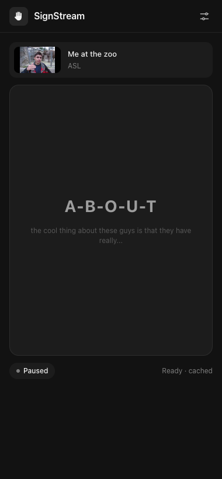
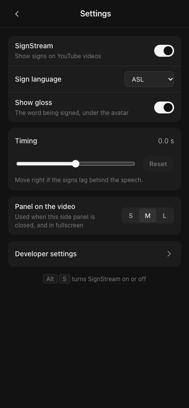
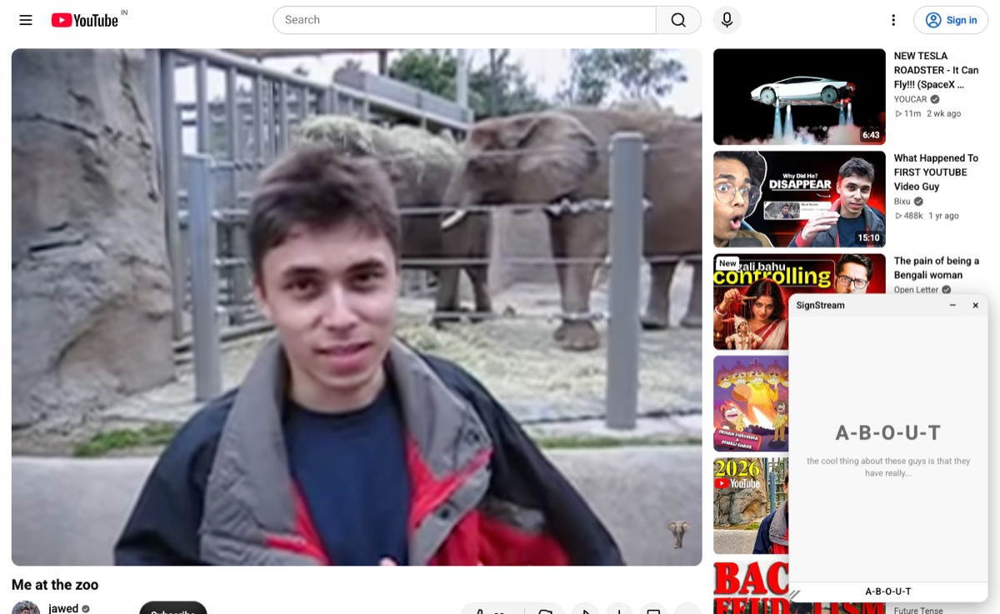

# @signstream/extension

Owner: **Poonam** · Spec: [specs/poonam.md](../../specs/poonam.md)

Chrome MV3 extension that adds the signing avatar to YouTube watch pages, in sync with the video.

- **Side panel (main view):** click the SignStream icon and the avatar docks on the right, like Phantom's side panel. YouTube shrinks to make room, so nothing covers the video. Settings live here too (the sliders icon).
- **Floating panel on the video:** shown while the side panel is closed, and in fullscreen (where Chrome hides the side panel).

| Side panel | Settings | Floating panel |
|---|---|---|
|  |  |  |

## Run it

```sh
pnpm install                                   # from the repo root
pnpm --filter @signstream/extension dev        # rebuilds apps/extension/dist on every save
```

Open `chrome://extensions`, turn on **Developer mode**, click **Load unpacked** and pick `apps/extension/dist`. Open any YouTube video.

- **No API running?** Open the side panel → settings → **Developer settings** → **Demo mode**. Every video then plays the team's 60-second mock (`mocks/sign-track.sample.json`, through the shared client's mock mode), so you can check the avatar and the sync.
- **API origin is fixed at build time** (PLAN §11): `http://localhost:8787` by default (`apps/api` on `pnpm dev`). For a release build, run `VITE_SIGNSTREAM_API_ORIGIN=https://<deployed-api> pnpm --filter @signstream/extension zip`. The manifest's only host permission is that origin, the worker can't call anything else, and anything that isn't a bare http(s) origin fails the build.
- After a change, click ↻ on the extension in `chrome://extensions` and refresh the YouTube tab. (`dev` is `vite build --watch`, not the CRXJS dev server: that one serves the side panel and worker from localhost and reloads the whole extension, which breaks the YouTube tab's connection.)

| Command | What it does |
|---|---|
| `pnpm --filter @signstream/extension build` | Production build in `dist/` |
| `pnpm --filter @signstream/extension zip` | Build + `signstream-extension.zip` for the GitHub release |
| `pnpm --filter @signstream/extension test` | `bun test` (unit tests + DOM tests with happy-dom) |

## How it works

```
side panel (React)                         content script (youtube.com)               background worker
  App / WatchView / SettingsView             app.ts      SPA navigation, one session      index.ts   "sign-track" port:
  active-tab.ts  connects to the active ───▶ sidebar-link.ts  page info + <video>         fetch, poll, cache,
                 tab ("sidepanel" port)                     state (events + timeupdate)   side panel on icon
  remote-video.ts  the video's clock,        session.ts  floating panel + player          click, Alt+S
                   interpolated between      panel.ts    Shadow DOM: drag, resize,
                   updates                               minimize, snap, saved layout
  avatar/  player, placeholder, sync loop ── shared with the floating panel ──
```

- **Sync:** `avatar/sync.ts` runs a rAF loop that calls `player.tick(time + offset)` and maps play/pause/seek/rate events. On the page it reads the `<video>` directly; in the side panel it reads `RemoteVideo`, which follows the snapshots the page sends (~4×/s plus every media event) and runs on the local clock in between.
- **Ads:** while `#movie_player` has `ad-showing`, the avatar doesn't tick (the `<video>` shows ad time) and both views say "Ad playing".
- **Fullscreen:** the floating panel moves inside `document.fullscreenElement` and stays above YouTube's controls (also when the side panel is open, since Chrome hides it in fullscreen).
- **Shorts** are skipped. **Live streams** show "not supported" without calling the API.
- **Partial tracks:** while the API is still processing, each cumulative snapshot replaces the track and plays right away; a small "Preparing more signs…" note shows the progress.
- **Buffering and robustness:** `waiting`/`stalled` freeze the avatar until `playing`; a hidden tab re-samples on return; a minimized panel stops rendering; a URL poll backs up `yt-navigate-finish`; a replaced `<video>` is followed.

- **Data:** sign tracks are the shared `SignTrack` type and are fetched with the shared `createApiClient().getSignTrack` in the worker (`background/sign-track-source.ts`). Every message between the content script, side panel and worker is validated with zod (`src/messages.ts`); track requests carry a request id, and the client reconnects if the worker is suspended mid-request.

## Waiting on teammates

- **`src/avatar/player.ts`** uses Hasan's `createAvatarPlayer` as soon as `@signstream/player` exports it, and owns the PLAN §4.4 `AvatarPlayer` type until that package exports it. Until then, a placeholder labelled "Placeholder" prints the current gloss as text.
- **Sign assets:** the build copies `packages/sign-assets` to `assets/` (Vite's own chunks go to `chunks/`), and the player gets `assetsBaseUrl: chrome.runtime.getURL("assets/")`.
